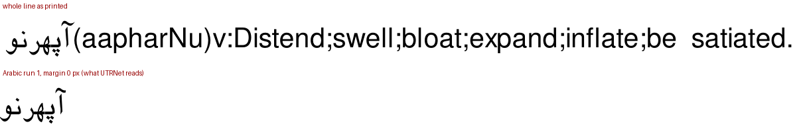
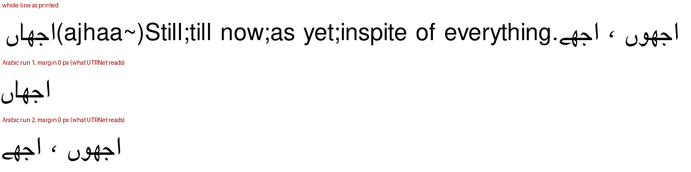
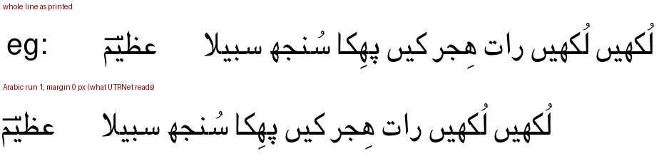
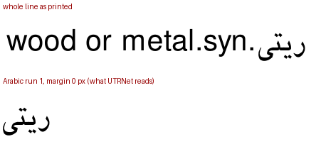
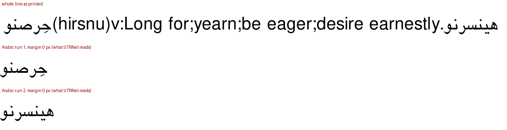
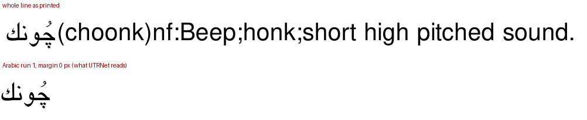
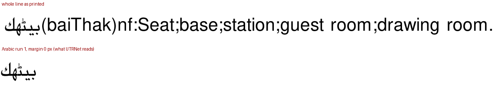
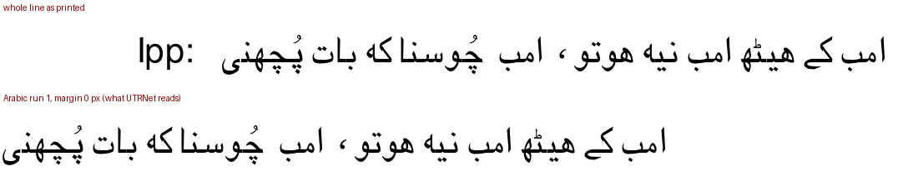
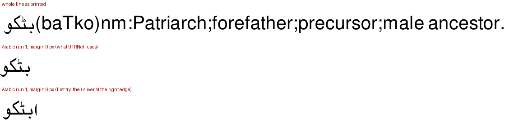

# UTRNet-Large zero-shot test on Gojri dictionary lines

Date: 2026-11-05. Status: finished.

Question: can a pretrained Urdu OCR model read the Gojri Nastaliq of our dictionary with no training on Gojri?

Short answer: yes, when it gets only the Arabic-script parts of a line. It makes 2.1% letter errors. Our own models make 35% to 36% on the same lines. UTRNet cannot read the English parts of the lines (86% error), so a new book needs a step that separates Arabic from English first.

## What was tested

Book. The *Concise Gojri-English Dictionary* by Dr. M. R. Anjum Awan (`pdfs/anjumshanasi/Gojri-English-Dictionary.pdf`, body pages 25 to 498). Each line has a Nastaliq headword, a Roman spelling in brackets, an English definition, and sometimes a Nastaliq example sentence. The Nastaliq uses the Batool font. The English uses a Latin font.

Lines. The 200 lines the user checked by hand (`data/reviews/dictionary-200-lines/labels_review_test.jsonl`). The book was cut into 200 equal parts in page order and one line was drawn from each (seed 20261103, built by `scripts/review/build_review.py`). The lines come from 192 different pages, 26 to 498. Together they hold 1,400 Arabic-script letters (short vowel marks not counted) and 9,370 other characters (English, digits, punctuation). Five lines have no Arabic at all. The retrained CRNN never saw these lines in training. The baseline CRNN did.

Truth. The `text_fix` field of each line: the text the user corrected while checking the line against the printed page (source file `data/reviews/dictionary-200-lines/marks_final_20261104.json`). A native Gojri speaker made these corrections. A dozen words still carry spellings that the user has since ruled differently (see the error table).

## The models

| Name | What it is | Trained on |
|---|---|---|
| UTRNet-Large | Open Urdu OCR model (paper arXiv 2306.15782, code commit `049c2d6`, 47.3 million weights, 189 MB file). We did not train it. | Printed Urdu (the authors' UTRSet-Real and UTRSet-Synth sets, as named on its model card) |
| Our CRNN, baseline | Small CRNN-CTC model, SageMaker job `gojri-crnn-2026-11-03-16-56-03-308` | Dictionary lines with the old Gemini labels, plus synthetic lines |
| Our CRNN, retrained | Same model, job `gojri-crnn-2026-11-05-16-02-39-998` | Dictionary lines with the rebuilt labels (the 200 test lines left out), plus synthetic lines |

UTRNet runs on the CPU of the local machine. No AWS service was used for it. The code and the weights are third-party files. The UTRNet README gives the license as CC BY-NC-SA 4.0 and the file headers say CC BY-NC 4.0. Either way it is for research use only. The files are not stored in this repository.

## How a line is prepared

1. The PDF stores every character with its font and a box (left and right edge in points). Letters in the Batool font are Arabic. All other letters are English.
2. A line crop (`data/synth/real_pairs/img`, about 300 DPI) is the printed line cut out of the rendered page. We know its left edge in points.
3. For each group of neighbouring Batool glyphs in the line (a run) we take the left edge of the first glyph and the right edge of the last. We convert both to pixels in the crop: points times 4.2, minus the left edge of the crop.
4. The crop is cut at those pixels. The margin is the number of extra pixels kept on each side. We tested 0, 2 and 6 pixels.
5. UTRNet gets each run as a grey image, mirrored left to right (it reads right to left), scaled to 32 px high (at most 400 px wide) and padded on the right. Its outputs for the runs of one line are joined with spaces.
6. Our CRNN gets the whole line (scaled to 64 px high), or the same runs.

The 6 px margin was our first try. It catches a thin vertical sliver of the bracket that follows the Arabic word. UTRNet reads that sliver as an alef. A margin of 0 removes it. The last example below shows this.

## How the error is calculated

For each line, the reference (the user's fix) and the model output are normalised in the same way:

- Unicode NFC form.
- All short vowel marks removed.
- Only Arabic-block characters kept. Spaces, English letters and digits are dropped.
- ك is treated as ک, and ه as ہ. The two-eyed heh ھ stays a separate letter. This follows the user's spelling rulings.

The error is the Levenshtein distance between the two strings (the smallest number of inserted, deleted or replaced letters), summed over all 200 lines and divided by the total number of reference letters (1,400). It can pass 100% when a model adds many letters. A line is exact when the distance is 0. The same normalisation and formula apply to every system in the tables.

## Results

Arabic-script letters, 200 lines, 1,400 reference letters:

| System | Input | Error | Wrong letters | Exact lines |
|---|---|---|---:|---:|
| UTRNet-Large | Arabic runs, 0 px margin | **2.1%** | 29 | 179 |
| UTRNet-Large | Arabic runs, 2 px margin | 2.8% | 39 | 168 |
| UTRNet-Large | Arabic runs, 6 px margin | 10.9% | 152 | 69 |
| UTRNet-Large | whole line (English included) | 221.5% | 3,101 | 1 |
| Our CRNN, baseline | whole line | 35.4% | 496 | 49 |
| Our CRNN, retrained | whole line | 36.1% | 505 | 60 |
| Our CRNN, baseline | Arabic runs, 0 px | 66.1% | 926 | 7 |
| Our CRNN, retrained | Arabic runs, 0 px | 63.9% | 894 | 7 |

Run-to-run variation (checked 2026-11-20). UTRNet keeps its temporal dropout on at inference: each read averages five
random masks drawn with `np.random` (`modules/dropout_layer.py` in the UTRNet code). So two runs without a fixed seed
can differ by a few letters. The table above is one such run (2026-11-05). `scripts/utrnet_arabic_eval.py` now takes
`--seed` (default 0), and one seed gives the same output every time (two seed-0 runs were byte-identical). At 0 px
margin, seed 0 gives 29 wrong letters (2.1%) and 179 exact lines. Seeds 0 to 4 give 28 to 31 wrong letters (2.0% to
2.2%, mean 2.1%) and 176 to 179 exact lines. Six runs without a seed on this machine gave 28 to 32 (2.0% to 2.3%). Report the
result as 2.1% (2.0% to 2.2% over five seeds). The 2 px and 6 px rows and the CRNN rows are single runs.

Update 2026-11-06: the user checked the two open heh forms against the print. p71 L18 is بدھنو (the reference was right, UTRNet wrote ہ). p125 L26 is پیلاھنگو (the reference had ہ and was wrong, UTRNet was right). The test file `labels_review_test.jsonl` now has ھ for p125 L26. One error less everywhere that line counted a heh error.

Five lines have no Arabic. They count as exact when the output has no Arabic letters. UTRNet on a whole line writes Arabic letters for the English words, so it adds many letters and the error passes 100%.

English parts (`scripts/utrnet_latin_eval.py`): 214 English runs, 7,965 letters and digits. The reference is the text stored in the PDF. UTRNet with its normal mirrored input makes 85.6% errors (6,819 characters). Without mirroring it makes 90.0%. It writes Arabic letters and digits for English letters. For example `(aalsi)adj.Lazy;sluggish;...` came out as `(566l)e6].-ک۶:-ان00...`. The model was trained on Urdu, where English is rare.

UTRNet at 0 px margin, by length of the reference:

| Reference length | Lines | Letters | Wrong letters | Error |
|---|---:|---:|---:|---:|
| 1 to 10 letters | 158 | 844 | 12 | 1.4% |
| 11 to 24 letters | 35 | 482 | 15 | 3.1% |
| 25 letters or more | 2 | 74 | 3 | 4.1% |

Only two lines are long, so the test says little about long Nastaliq sentences.

## The 29 errors at 0 px margin

Counts below were taken before the 2026-11-06 heh ruling: one replaced letter (p125 L26) is no longer an error, so 19 replaced, 4 deleted and 6 inserted, in 22 lines. All 22 lines (p30 L25 means page 30, line 25):

| Line | Reference | UTRNet | Wrong | What it is |
|---|---|---|---:|---|
| p30 L25 | ابو،ادو،بابو | ابوادو،بابو، | 2 | comma in a different place |
| p50 L2 | امبکےہیٹھامبنیہہوتو،امبچوسناکہباتپچھنی | امبکےھیٹھامبنيہھوتو،امبچوسناکہباتپچھنی | 3 | 2 old reference spellings (ہ for ھ, user confirmed ھ); 1 Arabic yeh ي for ی |
| p71 L18 | بدھنوبدھی | بدہنوبدھی | 1 | model error (ھ read as ہ; user checked the print) |
| p87 L7 | بیٹھک | بیٹھا | 1 | model error (ک read as ا) |
| p100 L16 | پترپیلاہونا | پترپیلاھونا | 1 | old reference (user confirmed ھ) |
| p109 L12 | پرہیز | پرھیز | 1 | old reference (user confirmed ھ) |
| p125 L26 | پیلوپیلاہنگو | پیدپیلاھنگو | 2 | 2 model errors (پیلو read as پید); the heh form is right (user checked the print, the reference was wrong) |
| p140 L24 | ترغیب | ترغيب | 1 | Arabic yeh ي for ی |
| p164 L24 | ریتی | دیتی | 1 | model error (ر read as د) |
| p165 L25 | ٹنڈھوروگیی،گھنیاری | ٹنڈھوروگئی،گھنیاری | 1 | old reference (user confirmed گئی) |
| p168 L22 | ٹھارٹھنڈوٹھار،کوراہار | ٹھاراٹھنڈوٹھار،کوراھار | 2 | 1 old reference (ہار, user confirmed ھ); 1 extra ا |
| p227 L3 | حرصنوہینسرنو | جرصنوھینسرنو | 2 | 1 old reference (user confirmed ھ); 1 model error (ح read as ج) |
| p239 L4 | لمےداءصاف | المےداءصاف | 1 | extra ا |
| p242 L20 | دردردرکیٹھوکر | درادردرکیٹھوکر | 1 | extra ا |
| p291 L8 | زباںدینی | زباندینی | 1 | old reference (user confirmed زبان) |
| p356 L18 | قانوں | قانون | 1 | old reference (user confirmed قانون) |
| p423 L20 | لچک | لچ | 1 | missing ک |
| p429 L3 | لنگوٹلنگوٹی | النگوٹالنگوٹی | 2 | 2 extra ا |
| p431 L22 | لھنو | کھنو | 1 | ل read as ک |
| p439 L6 | مٹیرومٹیری | مٹیرومثیری | 1 | ٹ read as ث |
| p482 L10 | والدوالدہوالدین | والدوالدہوالدين | 1 | Arabic yeh ي for ی |
| p486 L19 | ہاضمو | ہاضو | 1 | missing م |

Nine of the 29 errors are old reference spellings that the user has since overruled. UTRNet agrees with the user there. The other 20 are model errors: 5 extra alefs, 3 Arabic yeh, 2 comma placements, 2 missing letters, 2 letters in `پیلو`, 1 heh (p71) and 5 other replaced letters. With the nine corrected, the error is 20 of 1,400, about 1.4%. A rule that maps ي to ی would remove 3 more.

## Examples (real crops)

Each picture shows the whole line as printed, then the Arabic run or runs exactly as UTRNet received them at 0 px margin. The tables give the outputs after the normalisation above.

### Page 26, line 7



Short headword. UTRNet exact. Our CRNNs wrong.

| Reader | Output (Arabic letters only) |
|---|---|
| Reference (user's fix) | آپھرنو |
| UTRNet, 0 px margin | آپھرنو |
| UTRNet, 6 px margin | آپھرنو |
| Our CRNN, baseline | پھپرنو |
| Our CRNN, retrained | آھپرنو |

### Page 35, line 15



Three words in one line. UTRNet exact at 0 px. At 6 px it adds a leading و and a final ۔.

| Reader | Output (Arabic letters only) |
|---|---|
| Reference (user's fix) | اجھاںاجھوں،اجھے |
| UTRNet, 0 px margin | اجھاںاجھوں،اجھے |
| UTRNet, 6 px margin | واجھاںاجھوں،اجھے۔ |
| Our CRNN, baseline | اجاںاجی،جھوں |
| Our CRNN, retrained | اجاںاھ،جھ |

### Page 316, line 9



The longest exact line (36 letters): a Nastaliq example sentence. UTRNet exact at 0 px and at 6 px. Both CRNNs fail.

| Reader | Output (Arabic letters only) |
|---|---|
| Reference (user's fix) | لکھیںلکھیںراتہجرکیںپھکاسنجھسبیلاعظیم |
| UTRNet, 0 px margin | لکھیںلکھیںراتہجرکیںپھکاسنجھسبیلاعظیم |
| UTRNet, 6 px margin | لکھیںلکھیںراتہجرکیںپھکاسنجھسبیلاعظیم |
| Our CRNN, baseline | ایابھککھیگھکیکھکھاےں |
| Our CRNN, retrained | خاتکھکیکیکوکھیکیکیکای |

### Page 164, line 24



UTRNet error at 0 px: ر read as د. At 6 px the letter is right but it adds ۔.

| Reader | Output (Arabic letters only) |
|---|---|
| Reference (user's fix) | ریتی |
| UTRNet, 0 px margin | دیتی |
| UTRNet, 6 px margin | ریتی۔ |
| Our CRNN, baseline | درتی |
| Our CRNN, retrained | رت |

### Page 227, line 3



Two runs. UTRNet writes ھ at the start of the second word. The print shows ھ and the old reference has ہ, so this is not an error of the model. The first word has a real error: ح read as ج.

| Reader | Output (Arabic letters only) |
|---|---|
| Reference (user's fix) | حرصنوہینسرنو |
| UTRNet, 0 px margin | جرصنوھینسرنو |
| UTRNet, 6 px margin | اجرصنوھینسرنو۔ |
| Our CRNN, baseline | حرنومھیرنو |
| Our CRNN, retrained | حرسنوھیرن |

### Page 215, line 15



UTRNet exact at 0 px. At 6 px it adds a leading ا and reads ک as گ.

| Reader | Output (Arabic letters only) |
|---|---|
| Reference (user's fix) | چونک |
| UTRNet, 0 px margin | چونک |
| UTRNet, 6 px margin | اچونگ |
| Our CRNN, baseline | چوک |
| Our CRNN, retrained | چنک |

### Page 87, line 7



UTRNet error at 0 px: the final ک is read as ا. At 6 px it adds a leading ا but reads the final ک correctly.

| Reader | Output (Arabic letters only) |
|---|---|
| Reference (user's fix) | بیٹھک |
| UTRNet, 0 px margin | بیٹھا |
| UTRNet, 6 px margin | ابیٹھک |
| Our CRNN, baseline | بیٹک |
| Our CRNN, retrained | بھیٹک |

### Page 50, line 2



A long example line. Two words in the old reference (ہیٹھ and ہوتو) start with ہ. The print shows ھ and UTRNet writes ھ. The one real error is ی written as the Arabic yeh ي.

| Reader | Output (Arabic letters only) |
|---|---|
| Reference (user's fix) | امبکےہیٹھامبنیہہوتو،امبچوسناکہباتپچھنی |
| UTRNet, 0 px margin | امبکےھیٹھامبنيہھوتو،امبچوسناکہباتپچھنی |
| UTRNet, 6 px margin | امبکےھیٹھامبنيہھوتو،امبچوسناکہباتپچھنی |
| Our CRNN, baseline | اپپکیپی،جینےسےکےکای |
| Our CRNN, retrained | ماپھیکیتیچیسکےککےپھ |

### Page 66, line 9



The margin test. At 0 px UTRNet is exact. At 6 px the crop contains a sliver of the bracket at its right edge, and UTRNet writes an extra ا.

| Reader | Output (Arabic letters only) |
|---|---|
| Reference (user's fix) | بٹکو |
| UTRNet, 0 px margin | بٹکو |
| UTRNet, 6 px margin | ابٹکو |
| Our CRNN, baseline | بٹکو |
| Our CRNN, retrained | بٹکو |

## Limits

- The Arabic runs were cut with glyph boxes read from the PDF. A scanned page has no such boxes. Reading a new book needs a step that finds the text lines and tells Arabic from English. That step is not built or tested.
- One printed book, clean type, mostly short headwords (158 of 200 lines have 1 to 10 Arabic letters, and 5 have none). Two lines are long.
- The reference has about a dozen old spellings (nine counted above, two not rechecked).
- UTRNet writes the Arabic yeh ي where Gojri uses ی, and it cannot tell ہ from ھ by rule. Both need a post-processing rule.
- The 12 gold pages were read later (2026-11-06) with a script segmenter and Tesseract for English: see `scripts/ocr_eval/README.md`.

## Files

| File | Content |
|---|---|
| `results.tsv` | One row per line: the reference, and the normalised output of every system |
| `summary.json` | The error counts behind the results table |
| `examples/` and `examples.json` | The crop pictures and the texts shown above |

To reproduce the results (about 15 minutes on a CPU): clone the UTRNet repository into a new folder, download UTRNet-Large from the link in its README as `large.pth`, put `Gojri-English-Dictionary.pdf` (the *Concise Gojri-English Dictionary*; get it from its original source, credits in `data/pdf-corpus/CREDITS.tsv`) at `pdfs/anjumshanasi/`, then run from the repository root. The line crops and the page flags are tracked in `data/reviews/dictionary-200-lines/`; no other local files are needed:

```
py -3 -X utf8 scripts/utrnet_arabic_eval.py --repo <clone> --weights <large.pth> --pads 0 2 6 --crnn-base <baseline crnn_last.pt> --crnn-new <retrained crnn_last.pt> --report-dir data/utrnet-test
py -3 -X utf8 scripts/utrnet_latin_eval.py --repo <clone> --weights <large.pth>
```

The two CRNN files are in `s3://gojri-ai-sagemaker-data/output/<job name>/output/model.tar.gz`. A first scratch version of the test gave 2.2%, 2.8% and 11.5% for the three margins. The scripts above give the numbers in this file. Add `--seed N` to fix the dropout draw (see the run-to-run note under
the results table).

## Next (done)

The next step was to read the 12 gold pages with UTRNet. That is done (2026-11-06): the page pipeline in `scripts/ocr_eval/` (SegNet script labels, UTRNet for Arabic, Tesseract for English) reaches 3.7% Arabic-letter error on the 12 gold pages. See `scripts/ocr_eval/README.md`.
